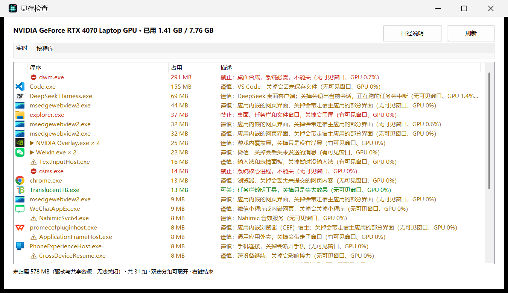
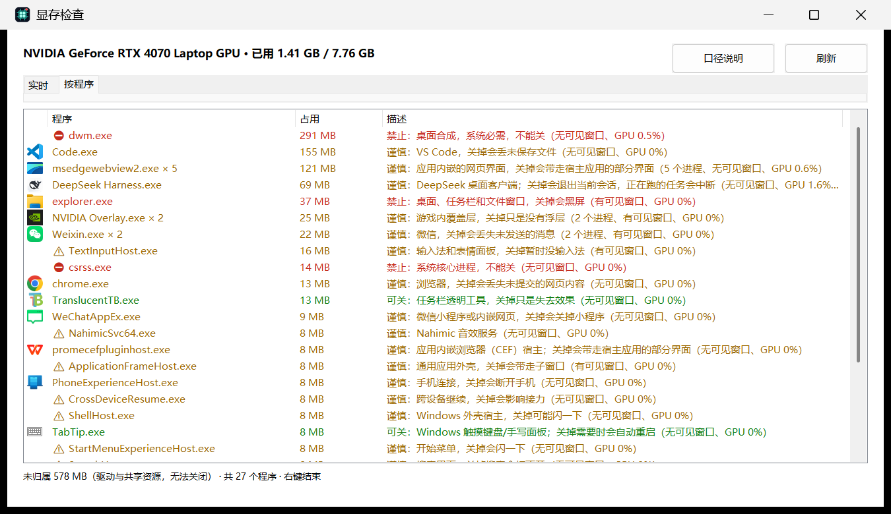

<div align="center">

# 显存检查 · VRAM Check

**谁占着显存、它是干什么的、关掉能省多少。**

Windows 10 / 11 · 单文件 · 无需安装 · MIT


[下载最新版](https://github.com/Altriaqe/vram-check/releases/latest) ·
[问题反馈](https://github.com/Altriaqe/vram-check/issues) ·
[开发文档](docs/ARCHITECTURE.md)

</div>

## 项目概述

Windows 任务管理器能告诉你"显存快满了"，但很难回答三个更实际的问题：**是谁占的、这个进程是干什么的、关掉会不会出事**。

显存检查是一个约 300 KB 的 Windows 桌面小工具，把这三个问题放进一张三列表里：

- **程序**：按进程树分组，同组进程可以展开看 PID；
- **占用**：只统计真正落在这块显卡上的「本地显存」，各进程相加不会超过整卡；
- **描述**：用一句人话说清它是谁、关掉会怎样，并给出"禁止 / 谨慎 / 可关"的风险判断。

它面向被显存挤爆的游戏玩家、跑本地模型/Stable Diffusion 的开发者，以及任何想弄清"这 500 MB 到底是谁吃的"的人。

## 项目效果

<p align="center">
  
  
</p>

- 左：**实时**页，按进程树分组，`▶` 可展开成员 PID；
- 右：**按程序**页，同名进程合并成一行（如 `msedgewebview2.exe × 5`），看每个程序的总占用。

界面里的数字来自 Windows 性能计数器，不是估算；不认识的程序会读 exe 自带的版本信息，而不是只显示"未知"。

## 项目特点

- 🔍 **只算本地显存**：用 `Local Usage`，不像"专用显存"那样把共享画面重复算给多个进程，相加不会超过整卡。
- 🧠 **277 条程序规则**：系统进程、驱动、安全软件、浏览器、开发/AI 工具、游戏、WPS/Office 等常用软件。
- 🏷️ **未知程序也能说清是谁**：读 exe 的 `FileDescription` / `CompanyName`，显示"程序自述……，厂商……"，风险仍标"未知"，不瞎猜。
- 🖼️ **进程自带图标**：从 exe 里抽 16px 小图标显示在行首；没有图标的程序保留原来的风险符号，不会留空。
- ⚡ **每秒刷新，不打断操作**：刷新时保留选中行和滚动位置；采样稳态约 2–3 ms。
- 📑 **两个页签**：实时（按进程树）/ 按程序（按名字合并）。
- 🖱️ **右键结束任务**：先发 `WM_CLOSE`，3 秒后仍活着才询问是否强制；强杀前核对进程创建时间，防 PID 复用。
- 🚫 **系统进程有护栏**：`dwm.exe`、`explorer.exe`、`csrss.exe` 等标记为禁止关闭，菜单项直接置灰。
- 🧮 **未归属单独显示**：驱动和共享资源占的部分不摊给进程，避免"每个进程都多算一点"。
- 🪶 **轻**：单文件约 300 KB，常驻约 23 MB，失焦/最小化停止轮询。
- 🖥️ **老系统能降级**：读不到显存计数器时自动切「内存」列，界面说明原因，而不是空白或报错。
- 🎨 **原生外观**：Win32 + comctl32 v6，跟随系统浅色/深色主题，不背 Electron/WebView。

## 快速开始

### 下载即用

1. 打开 [Releases](https://github.com/Altriaqe/vram-check/releases/latest)，下载 `vram-check.exe` 或 `vram-check-*-win64.zip`；
2. 双击运行，无需安装、无需管理员权限；
3. 想结束某个程序：右键该行 → **结束任务**。

> **系统要求**：Windows 10 1709+ / Windows 11（x64）。
> exe 尚未代码签名，首次运行可能出现 SmartScreen 提示；选择"更多信息 → 仍要运行"即可。

### 从源码构建

需要 Rust 1.75+ 与 MSVC Build Tools：

```powershell
git clone https://github.com/Altriaqe/vram-check.git
cd vram-check
cargo build --release
.\target\release\vram-check.exe
```

也可以直接：

```powershell
cargo run --release
```

## 使用说明

- **实时页**：双击带 `▶` 的分组行展开/收起成员；单击选中，右键弹出「结束任务 / 刷新」。
- **按程序页**：同名进程合并；适合回答"微信一共吃了多少显存"。
- **结束任务**：默认只发关闭请求；3 秒后进程还在，才弹窗询问是否强制结束。强制前会核对 PID 和创建时间。
- **口径说明**：右上角按钮，解释为什么这里的数字和任务管理器不一样。
- **结果反馈**：关闭后在底部显示"已结束 N 个进程 · 整卡已用 X → Y"，用实测前后对比，不拿进程字节数冒充实测。

## 工作原理

```text
DXGI → 显卡容量
PDH  → 每个进程的 Local / Non Local、整卡 Dedicated、引擎占用率
Toolhelp32 → 进程名、父进程、PID
版本资源 → 未知程序的程序名 / 厂商
        ↓
进程树聚合 → 两个页签 → 风险规则 + 文案
```

几个关键口径：

- **容量**来自 DXGI `DedicatedVideoMemory`，不是 WMI（WMI 在 >4 GB 的卡上会截断）。
- **进程占用**来自 `\GPU Process Memory(*)\Local Usage`；整卡来自 `\GPU Adapter Memory(*)\Dedicated Usage`。
- **GPU%** 取所有引擎里的最大值，不求和。
- **未归属** = 整卡已用 − Σ(本地)，永远不为负；对不上时显示"口径异常"。

更完整的架构、线程模型和算法见 [docs/ARCHITECTURE.md](docs/ARCHITECTURE.md)，口径决策见 [ADR-004](docs/DECISIONS.md)。

## 常见问题

<details>
<summary><b>为什么和任务管理器的数字不一样？</b></summary>

任务管理器默认显示「专用显存」，它会把跨进程共享的画面重复统计给多个进程，空闲时相加也可能超过整卡。本工具用「本地显存」，只算真正落在这块卡上的部分，所以各进程相加不会超过整卡，差额单独显示为"未归属"。详见 [ADR-004](docs/DECISIONS.md)。
</details>

<details>
<summary><b>为什么 8 GB 的卡只显示 7.76 GB？</b></summary>

驱动会预留一部分显存，DXGI 报告的是系统实际可用的容量。这是正常的，不是读取截断；包装标称 8 GB 与可用容量本来就有差异。
</details>

<details>
<summary><b>"未归属"是什么？能关掉吗？</b></summary>

整卡已用里没有被任何进程的「本地显存」覆盖的部分，通常是驱动、桌面合成和共享资源。它不属于某个进程，所以不能通过结束进程释放。
</details>

<details>
<summary><b>为什么有些进程还是显示"未知"？</b></summary>

规则库没覆盖、且 exe 没有版本信息（或进程受保护读不到），才会显示"没有这条程序的资料"。只要程序带版本资源，就会显示"程序自述「…」，厂商…"，风险仍标"未知"，不会假装知道。
</details>

<details>
<summary><b>结束任务安全吗？</b></summary>

默认走正常关闭流程，和点窗口右上角的 × 一样；3 秒后仍不退出才询问强制。禁止关闭的系统进程不会执行。强制结束可能丢失未保存内容，弹窗里会说明。
</details>

<details>
<summary><b>杀软/SmartScreen 报警怎么办？</b></summary>

exe 未签名，Rust 二进制可能触发启发式误报（本项目实测卡巴斯基对 debug 产物报过一次）。源码完全公开、不联网、不写注册表、不常驻。建议只使用 Release 里的产物；开发时把仓库目录加入杀软排除项。看到"清除并重启"不要直接点，先核对文件来源。
</details>

<details>
<summary><b>支持 Windows 7 吗？</b></summary>

不支持。最低 Windows 10 1709；更低版本缺少部分 API。读不到显存计数器时会自动降级为「内存」视图，但系统本身仍需 Win10 1709+。
</details>

## 项目结构

```text
vram-check/
├── src/
│   ├── data/          采样、进程表、版本信息、数据模型
│   ├── explain/       277 条规则、风险分级、文案拼装
│   ├── action/        结束任务（WM_CLOSE → 确认 → 强杀）
│   ├── ui/            Win32 窗口与 ListView 封装
│   └── app.rs         生命周期、消息循环、两个页签
├── docs/              PRD、架构、规范、决策记录、实测报告
├── scripts/           守门、发布打包、图标生成
├── app.manifest       comctl32 v6 + PerMonitorV2 DPI
├── app.rc             图标 + 版本信息
└── Cargo.toml
```

更多文档：

| 文档 | 内容 |
|---|---|
| [docs/PRD.md](docs/PRD.md) | 产品需求、功能清单、验收标准 |
| [docs/ARCHITECTURE.md](docs/ARCHITECTURE.md) | 分层、数据流、线程模型、算法 |
| [docs/DECISIONS.md](docs/DECISIONS.md) | ADR：为什么用 Rust / 原生控件 / Local 口径 |
| [docs/CONVENTIONS.md](docs/CONVENTIONS.md) | 工程规范：unsafe、错误处理、文案、提交 |
| [docs/M1-MEASUREMENTS.md](docs/M1-MEASUREMENTS.md) | 体积、启动、采样、内存实测 |
| [SYNC.md](SYNC.md) | 开发交接：当前进度、测试纪律、环境台账 |

## 开发

```powershell
cargo fmt --check
cargo clippy --offline --all-targets -- -D warnings
cargo test --offline
```

真实显卡的 live 采样测试默认忽略，需要时手动跑：

```powershell
cargo test --offline -- --ignored --nocapture
```

发布前守门（体积 ≤ 2 MB、冷启动中位 ≤ 100 ms、依赖检查）：

```powershell
powershell -NoProfile -ExecutionPolicy Bypass -File scripts\gate.ps1
```

打发布包（守门 → 复制 exe/文档 → 压缩到 `release\`）：

```powershell
powershell -NoProfile -ExecutionPolicy Bypass -File scripts\release.ps1
```

测试策略：只给"算错会静默骗人"的纯逻辑写单测；不写冒烟/灰度/E2E，真实数据靠手动对照 `nvidia-smi` 和任务管理器验证。

## 许可证

本项目使用 [MIT License](LICENSE)。第三方说明见 [THIRD-PARTY-NOTICES.md](THIRD-PARTY-NOTICES.md)。

## 致谢

- [hypomnesis](https://github.com/PCfVW/hypomnesis)（MIT OR Apache-2.0）：PDH/DXGI 数据后端的思路来源。本项目按 Win32 API 自行实现，未复制源码。
- [xcyclopedia](https://github.com/strontic/xcyclopedia)（MIT）：调研进程说明数据时参考过，最终未内置（数据停在 2021 年，不覆盖新程序）。
- 所有提交 issue、反馈真实数据的热心用户。
