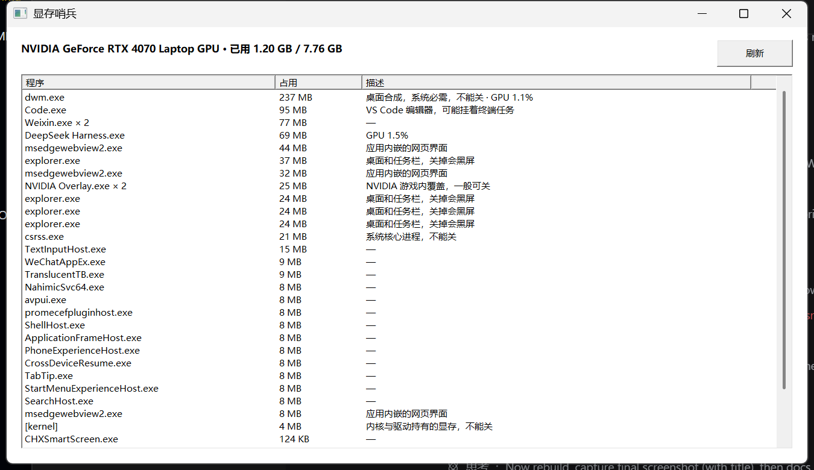

# M1 实测报告（数据层 + 三列表跑通）

| 项 | 内容 |
|---|---|
| 日期 | 2026-11-14 |
| 环境 | Windows 11 家庭中文版 · RTX 4070 Laptop 8GB · 驱动 596.49 · 150% 缩放 |
| 工具链 | Rust 1.100.0 stable (`x86_64-pc-windows-msvc`) + MSVC BuildTools |
| 构建 | `cargo build --release`（`opt-level="z"` + fat LTO + `panic=abort` + strip） |
| 结论 | **M1 出口达成**：真数据、三列表、口径正确；两项需要 M2/M4 处理（见 §5） |



---

## 1. 验收对照

| 需求 | 结果 | 证据 |
|---|---|---|
| F-01 单文件 ≤ 2 MB | ✅ **216,576 B（212 KB）**，为预算的 10.4% | `target/release/vram-check.exe` |
| F-02 冷启动 ≤ 100 ms | ⚠️ **98.3 / 100.2 ms（热），137.4 ms（首次冷启动）** | `WaitForInputIdle` 三次；首次含磁盘/杀软开销 |
| F-03 内存 ≤ 30 MB | ✅ 常驻 **15.9 MB** | 首屏后 Working Set |
| F-04 不常驻 | ✅ 关窗即退，无残留进程 | `CloseMainWindow` → `HasExited=True` |
| F-05 三列表 | ✅ 程序 / 占用 / 描述，一屏 28 行（150% 缩放） | 截图 |
| F-30 Local 口径 | ✅ 只用 `Local Usage`；未归属 `整卡 − Σ本地` | 同刻对照 PowerShell |
| F-31 容量走 DXGI | ✅ DXGI `DedicatedVideoMemory`；WMI 的 4095 未使用 | 见 §2 发现 1 |
| F-32 多适配器过滤 | ✅ 只采 PDH 真实报数的 LUID | 见 §2 发现 2 |

---

## 2. 数据与性能

### 2.1 数字

| 指标 | 实测 | 预算 |
|---|---|---|
| 单次采样（30 组 / 336 进程 / 437 引擎实例） | **8.9–9.7 ms** | ≤ 10 ms |
| 前台 CPU | 约 **21 ms/s**（采样 + 重绘） | — |
| 最小化 5 秒 CPU | **0 ms** | 0% |
| 采样线程启动预热 | 120 ms（两次 collect，等 GPU% 速率计数器） | 不占 UI |

同刻交叉验证（PowerShell `Get-Counter`）：

```
Local 合计     826.6 MB（36 个实例）   程序算得 811–818 MB
整卡 Dedicated 1210.0 MB
未归属         383 MB（按 PDH 原始值）
```

### 2.2 发现

**发现 1：DXGI 容量比 nvidia-smi 少约 240 MiB，但不是截断。**

| 来源 | 容量 |
|---|---|
| `DXGI_ADAPTER_DESC1.DedicatedVideoMemory` | **7948 MiB**（界面显示 7.76 GB） |
| `nvidia-smi` | 8188 MiB |
| WMI `AdapterRAM` | 4095 MiB（已知截断，禁用） |

差额是驱动保留，不是 32 位截断。结论：**继续用 DXGI（跨厂商、单一口径）**，PRD F-31 的"8188 MiB"表述按本机实测修正为"DXGI 报多少显示多少"；与任务管理器的差异进 F-33 帮助页。

**发现 2：本机 DXGI 枚举出 5 个同名 4070 + 1 个 Basic Render，PDH 只报 1 个 LUID。**

5 个克隆适配器容量都写 7948 MiB，按"容量最大"会挑错。现在 `choose_primary` 先用 PDH `GPU Adapter Memory` 找出**真正有数据的 LUID**，再匹配 DXGI 名字/容量；PDH 读不到时才退回容量排序。这条是 F-32 的实际实现。

**发现 3：未归属 33%，比 M0 空闲态的 6% 高。**

同一时刻 PowerShell 复算也是 383 MB 左右，说明不是聚合 bug。原因是整卡 `Dedicated Usage` 含驱动/共享 surface，而进程 `Local Usage` 不含；桌面活跃（WeChat/浏览器/DWM）时差距会变大。界面照实显示"未归属"，不摊派给任何进程。

**发现 4：GPU% 首次读会返回 `PDH_CSTATUS_INVALID_DATA`（0xC0000BBA）。**

`Utilization Percentage` 是速率计数器，必须有两个采样点。`Sampler::new` 先 collect 一次、等 120 ms，再进循环；否则首屏整次采样失败。

**发现 5（开发环境坑，不是产品 bug）：工作区被标成 Low 完整性，导致 Toolhelp 只能看到 21/336 个进程。**

`E:\Code\vram-sentinel` 目录上有一条 `Mandatory Label\Low Mandatory Level`，其下新生成的 exe 启动后进程令牌也是 Low，`CreateToolhelp32Snapshot` 只返回同完整性级的进程——界面大量 `?`。已把目录标签改为 Medium（`icacls ... /setintegritylevel (OI)(CI)M`），重建后恢复正常。这条与之前 DSH 沙箱的 ACL 报错同源。

---

## 3. 界面现状

- 三列 + 顶部总览条 + 刷新按钮；中文字体用系统 `Microsoft YaHei UI`，零内嵌。
- 描述列来自最小规则集（27 条），未命中显示 `—`；有 GPU 活动时补 `GPU x%`。
- 未归属行排在表尾；当前 30 组时需滚动才能看到（M2 处理固定/置顶）。

---

## 4. 复现

```powershell
$env:Path = "$env:USERPROFILE\.cargo\bin;$env:Path"
cargo test --offline                        # 16 个单测
cargo test --offline -- --ignored --nocapture  # live 采样，打印耗时与 Top 列表
cargo build --release --offline
(Get-Item .\target\release\vram-check.exe).Length / 1KB
```

---

## 5. 留给 M2 / M4 的事

| 项 | 归属 | 说明 |
|---|---|---|
| 冷启动 137 ms（首次冷） | M4 | 需在干净机器/无杀软干扰下复测；必要时延迟创建 ListView 或预取字体 |
| 未归属行滚动后不可见 | M2 | 固定行/置顶，或列表限高 + 独立汇总 |
| 风险图标与颜色双编码 | M2 | `explain/classify.rs` |
| 描述规则 27 → 200 条 | M2 | 换成 `rules.tsv` |
| 同会话多个 explorer.exe 成多行 | M2 | 多会话场景本应分开展示，但需要"会话"列或折叠；先记录 |

---

## 6. 结论

数据层成立：**真数据、真口径、真性能**，体积只有预算的十分之一。M1 可以收口，进入 M2 表达层。

**实现来源说明**：M1 的 PDH/DXGI/Toolhelp32 代码是按 Win32 API 自行实现的，未复制 hypomnesis 源码（与 ADR-003 的"精准移植"计划暂时不同）。后续若移植上游，需保留许可头并更新 `THIRD-PARTY-NOTICES.md`。
